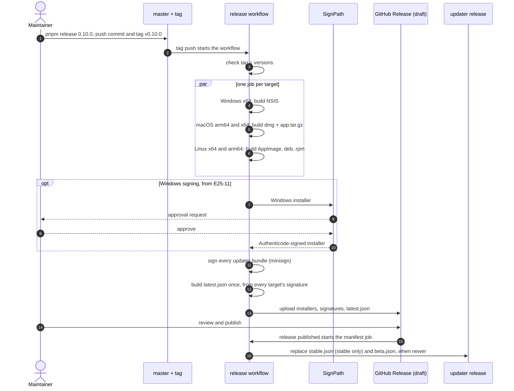
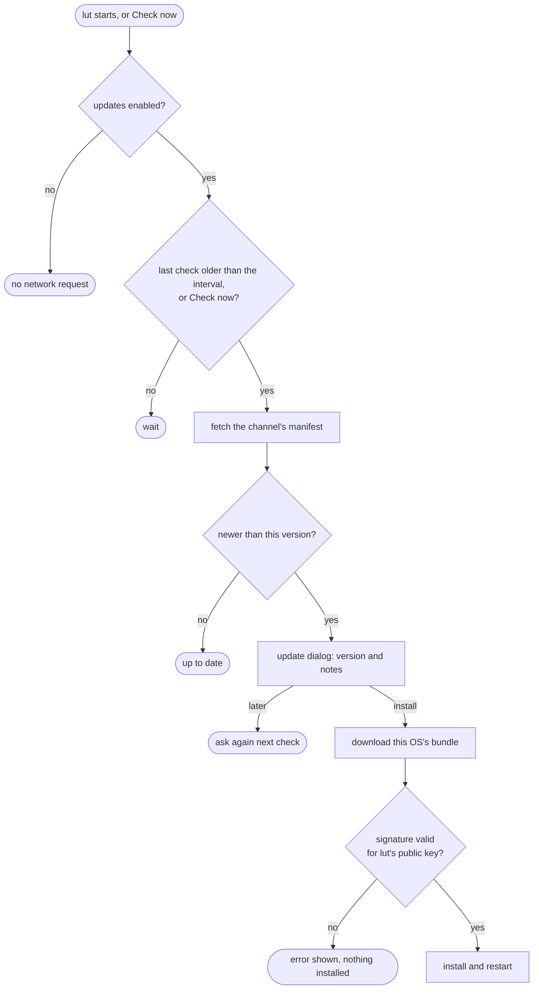

# Releasing lut

How a lut release is made, published and picked up by an installed lut. It is the design of E25 (release pipeline and
lut updater): each section names the issue that builds it. Decisions taken in E25-01; the build commands themselves
live in [build.md](build.md).

## Identities and channels

lut runs under two identities. An installed lut follows one of two update channels; a development build never
updates and never shares anything with an installed lut.

| Identity  | Identifier           | Built by                    | Updates from                    |
| --------- | -------------------- | --------------------------- | ------------------------------- |
| Installed | `dev.lucode.lut`     | the release workflow, a tag | its channel: `stable` or `beta` |
| Dev       | `dev.lucode.lut.dev` | `pnpm tauri dev` on a clone | never                           |

- **Channel.** `stable` gets releases `vX.Y.Z`; `beta` gets those and the pre-releases `vX.Y.Z-beta.N`. It is a
  setting of the installed app (E25-05), not a second app: switching channel keeps the same install and data.
- **What the identifier separates.** The app's config folder (settings, profiles, spaces), the WebView2/WebKit data
  (its local storage) and lut's runtime folder under the user cache (the control descriptor that `lut-cli` talks to,
  the shell integration). A debug build is the dev identity: `pnpm tauri dev` builds the app and `lut-cli` in debug,
  the app takes `dev.lucode.lut.dev` before it starts and both name their runtime folder after it, so a dev build and
  an installed lut share none of these (E25-10). The rule lives in `lut-control-protocol` (`IDENTIFIER`); a dev
  window's title says "lut (dev)", and neither lut reads the other's runtime folder.
- **Agent hooks** are shared on purpose: a hook runs `$LUT_CLI` from the pane that started the agent, so the same
  hook reaches whichever lut owns that pane.

## Versions and tags

lut follows semver, with its own versions: the repository says `0.0.0` until the first release (the version Terax
left, 0.9.0, was dropped in E25-02). The version lives in:

| File                   | Field                                  |
| ---------------------- | -------------------------------------- |
| `package.json`         | `version`                              |
| `src-tauri/Cargo.toml` | `package.version`, `workspace.package` |
| `src-tauri/Cargo.lock` | the workspace crates' entries          |

`src-tauri/tauri.conf.json` reads it from `../package.json`. Windows builds only the NSIS installer
(`tauri.windows.conf.json`), so there is no MSI version to keep: MSI versions cannot carry a pre-release tag.

A release starts with `pnpm release <version>` (`scripts/release.mjs`, E25-02), on an up-to-date, clean `master`:

1. checks the version is `X.Y.Z` or `X.Y.Z-beta.N` and newer than the current one; any other form (`-rc.1`,
   `-alpha`) is refused;
2. writes it into the files above and refreshes `Cargo.lock` (`cargo update --workspace`);
3. commits `release: 🔖 vX.Y.Z` and creates the signed tag `vX.Y.Z`.

Pushing the commit and the tag is left to the person releasing (`git push origin master vX.Y.Z`): nothing leaves the
machine until they decide. A `vX.Y.Z-beta.N` tag is a beta and a `vX.Y.Z` tag is stable.

The release workflow's first job applies the same rule (`node scripts/release.mjs --verify <tag>`): it fails the run
for a tag of any other form, when the tag and the versions in the files disagree, or when the tag is not on
`master`.

## How a release runs

- **Targets.** Windows x64; macOS arm64 and x64 (two builds); Linux x64 and arm64, on the oldest supported Ubuntu
  runner so the glibc requirement stays low. Each job builds `lut-cli` for its own target (`LUT_CLI_TARGET`, read by
  `scripts/build-cli.mjs`), so an x64 macOS bundle never carries an arm64 sidecar.
- **Signing order.** Authenticode changes the installer's bytes, so the updater signature is made after it, over the
  signed file. The signing keys are CI secrets; the public updater key is in `tauri.conf.json`. Only the workflow
  makes updater bundles (`createUpdaterArtifacts` through `--config`), so a local `pnpm tauri build` needs no key.
- **Windows signing comes later.** SignPath Foundation reviews a project before signing for it, which can take weeks,
  so the first releases ship the Windows installer without Authenticode (E25-11 adds it). The updater signature is
  there from the first release, so an installed lut updates to the first signed release like to any other.
- **One manifest job.** Every target job uploads its bundles and signatures as workflow artifacts; a single job after
  all of them writes `latest.json`. Terax let each job merge itself into the release's `latest.json` and then had to
  patch it in a final job, because parallel uploads overwrote each other.
- **Draft first.** The workflow never publishes. The release stays a draft until it is reviewed and published by
  hand; only then does an installed lut see it.
- **AppImage and Wayland.** Terax removed the bundled `libwayland-*` libraries from the AppImage and re-signed it: the
  copies from the build runner were older than the Mesa of recent distributions and broke EGL. lut keeps that step.

The workflow is `.github/workflows/release.yml` (E25-02):

- **check** verifies the tag and says whether it is a beta.
- **build**, one job per target, runs `pnpm tauri build --target … --bundles …` with `createUpdaterArtifacts` turned
  on through `--config` (it is not in `tauri.conf.json`, so a local build needs no key) and the signing key from the
  secrets; it installs `cargo-about` for the third-party notices (E25-03). The jobs keep their bundles and `.sig`
  files as workflow artifacts; the macOS ones rename `lut.app.tar.gz` after their architecture.
- **manifest** runs `scripts/build-manifest.mjs`, which writes `latest.json` from the `.sig` files with the platform
  keys the updater looks for (`windows-x86_64[-nsis]`, `darwin-{aarch64,x86_64}[-app]`,
  `linux-{x86_64,aarch64}[-appimage|-deb|-rpm]`, the plain Linux key being the AppImage) and fails when one is
  missing, then creates the draft release (a pre-release for a beta) with every file and generated notes.

A manual run (Actions > Release > Run workflow) does all of it except the release: it builds every target, the
macOS ones included, and keeps the bundles and `latest.json` as workflow artifacts. Run it before a first tag, or
after changing the workflow.

## Artifacts

| OS      | Download                 | Used by the updater       | Notes                                                                                                                                                                                           |
| ------- | ------------------------ | ------------------------- | ----------------------------------------------------------------------------------------------------------------------------------------------------------------------------------------------- |
| Windows | NSIS installer (`.exe`)  | the same `.exe`           | per-user install. Authenticode-signed through SignPath from E25-11; until then SmartScreen warns on the first install (More info > Run anyway). No MSI: it needs an administrator and no betas. |
| macOS   | `.dmg` (arm64, x64)      | `lut.app.tar.gz`          | the `.dmg` is only for the first install. Not signed with an Apple certificate yet: the first launch needs right-click > Open (see `future.md`).                                                |
| Linux   | AppImage, `.deb`, `.rpm` | the same file, per format | the updater replaces an AppImage in place; a `.deb` or `.rpm` update asks for the password to install.                                                                                          |

Every file the updater uses has a `.sig` next to it: the updater signature that an installed lut checks before
installing. `latest.json` points at those files, never at the `.dmg`.

## The update manifests

An installed lut reads one fixed URL per channel, both assets of a permanent release tagged `updater`:

- `https://github.com/lucas-labs/lut/releases/download/updater/stable.json`
- `https://github.com/lucas-labs/lut/releases/download/updater/beta.json`

Each is a copy of a release's `latest.json`, with the release's notes as they were when it was published. Publishing
a release runs `.github/workflows/update-manifests.yml`, which creates the `updater` release the first time and
replaces a manifest only when the release is newer than the version that manifest holds, so publishing an older draft
late never moves a channel back:

| Published release     | `stable.json`     | `beta.json`       |
| --------------------- | ----------------- | ----------------- |
| stable `v0.10.0`      | replaced if newer | replaced if newer |
| beta `v0.11.0-beta.1` | unchanged         | replaced if newer |

So the beta channel also gets every stable release, and neither channel ever goes back to an older version. Terax had one channel
and used `releases/latest/download/latest.json`, which GitHub resolves to the newest non-pre-release; a second channel
needs a URL of its own, and one mechanism for both keeps them alike.

## How an installed lut updates

- **Off means off.** With updates disabled lut makes no update request at all (E25-05).
- **Channel and throttle.** The channel picks the manifest URL at runtime, in Rust (`modules/updates.rs`): the
  plugin's JS check cannot change its endpoint. Unset, the channel follows the installed version. lut checks 10 s
  after start and then once every 24 h, keeping the time of the last check in `lut.updates.lastCheck`; a dev build
  never checks (E25-05). The plugin, its public key and the `updater:default` capability are E25-04.
- **The dialog and the settings controls** (channel, enable, Check now, in Settings > About) are E25-06, following
  lut's existing dialog and settings patterns. Installing restarts lut, so it goes through the same guard as quitting:
  with unsaved files or a running process the dialog warns and waits for Restart now.
- **Proof.** E25-07 updates an old build to a test release, and shows that a bundle with no signature or with another
  key's signature is refused, and that the only host contacted is lut's.

## Secrets

The workflow reads these repository secrets; their values never appear in the repository or in logs.

| Secret                               | Used for                                                   |
| ------------------------------------ | ---------------------------------------------------------- |
| `TAURI_SIGNING_PRIVATE_KEY`          | signing the updater bundles                                |
| `TAURI_SIGNING_PRIVATE_KEY_PASSWORD` | its password                                               |
| `SIGNPATH_API_TOKEN`                 | submitting the Windows installer for signing (from E25-11) |

## Issues

| Part                                         | Issue  |
| -------------------------------------------- | ------ |
| These decisions and this document            | E25-01 |
| Dev identity, isolated from an installed lut | E25-10 |
| Windows installer signed through SignPath    | E25-11 |
| `pnpm release`, workflow, manifests          | E25-02 |
| Third-party notices in every bundle          | E25-03 |
| Updater plugin wired to lut only             | E25-04 |
| Channel, disable and throttle                | E25-05 |
| Update dialog and settings controls          | E25-06 |
| End-to-end proof                             | E25-07 |
| Nix package proposal                         | E25-08 |
