
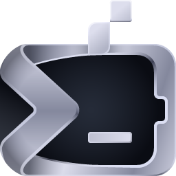

𝐥𝐮𝐭 - opinionated terminal that is actually a terminal

  
  
  

  <a href="https://github.com/lucas-labs/lut/releases">Download</a> •
  <a href=".docs/development/build.md">Build</a> •
  <a href=".docs/plan/plan.md">Roadmap</a>

 

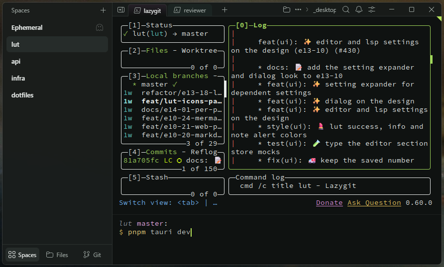

 

## Why lut?

Somewhere along the way terminals got ambitious. They grew chat panels, notebooks, accounts, onboarding screens and a
few hundred megabytes. The terminal became _a feature_ of the app.

`lut` goes the other way. It opens your shells and gets out of the way. Files, agents, Git and an editor are still there, folded in a drawer, until you actually want them.

## What it does

### Your shells

`lut` detects the shells on your machine and turns them into profiles, Windows Terminal style: shell, arguments,
starting folder, environment and looks.

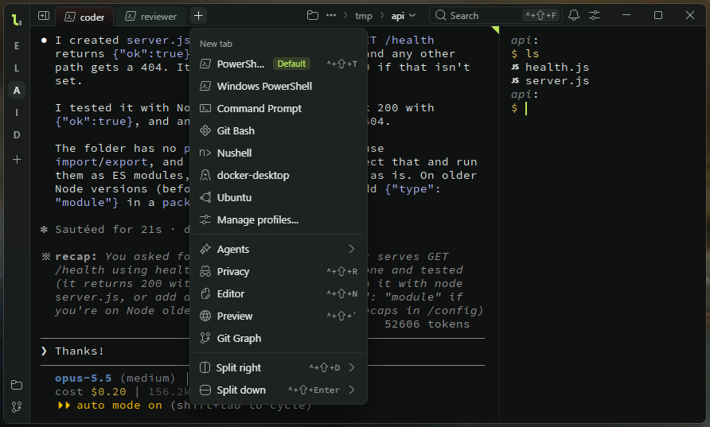

### Spaces

A space is a set of tabs and splits for one thing you work on: a repo, a server, a project, whatever. `lut` keeps them there for you, until you don't need them anymore.

### Tabs, your way

Horizontal tabs, vertical tabs, or a compact rail that keeps every pixel for the terminal (that's how I like it, btw).
Split any tab into multiple panes, right or down, and hide the sidebars when you don't need them.

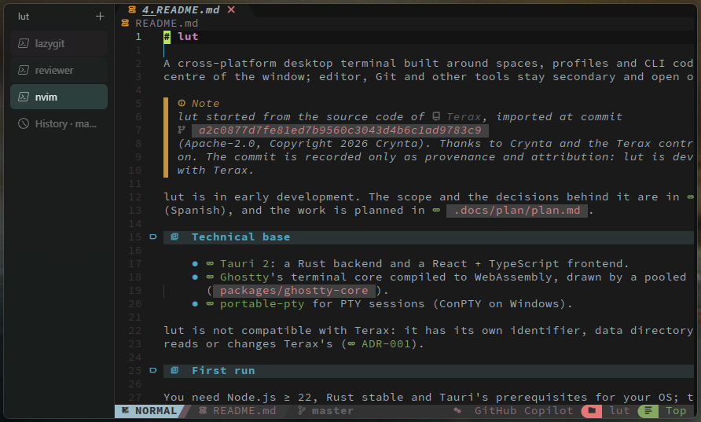

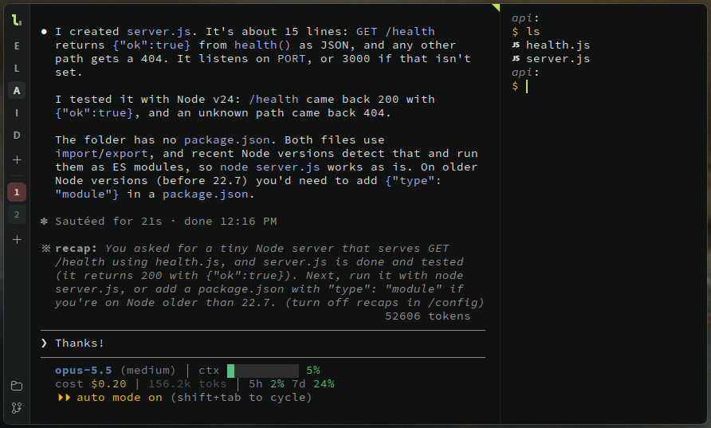

### AI Integration

`lut` doesn't ship its own AI chat. There are other tools for that and they are not called "terminals". `lut` watches the coding agents you already run in terminals (Claude Code, Codex, Gemini, Pi, OpenCode, Grok) and tells you when one finishes or needs you: a toast, a mark on its tab and space, and a notification if you like to be disturbed.

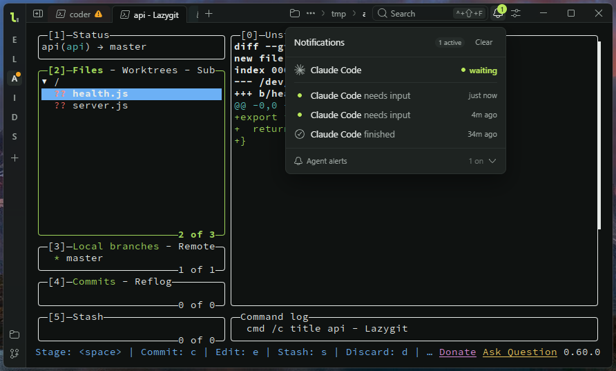

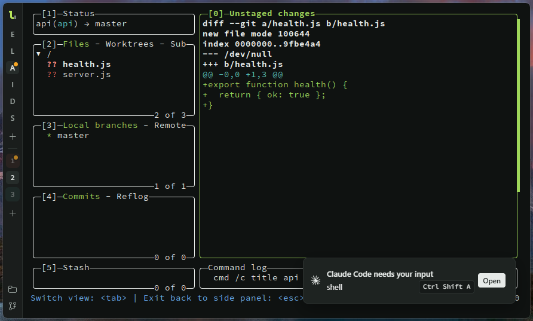

### Everything one shortcut away

Assign your own shortcuts to any action, and the command palette is always there to find commands, spaces, tabs and files.

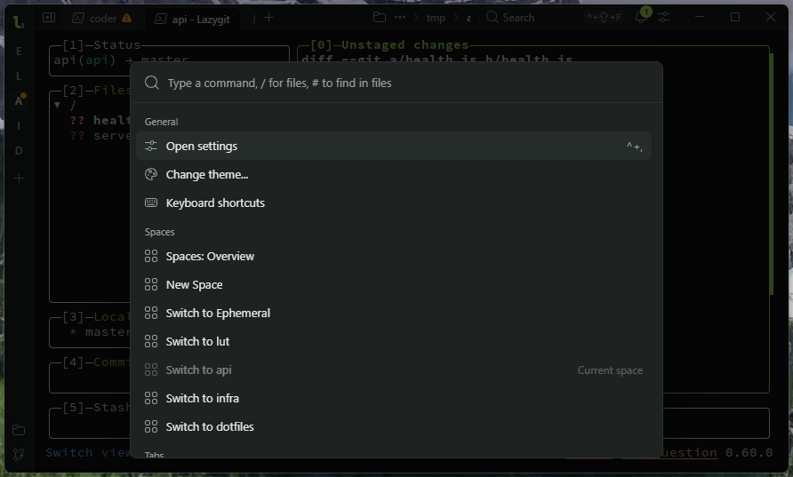

### Tools in the drawer

Source control, a file explorer, an editor with LSP and previews: there when you open them, out of your way when you don't.

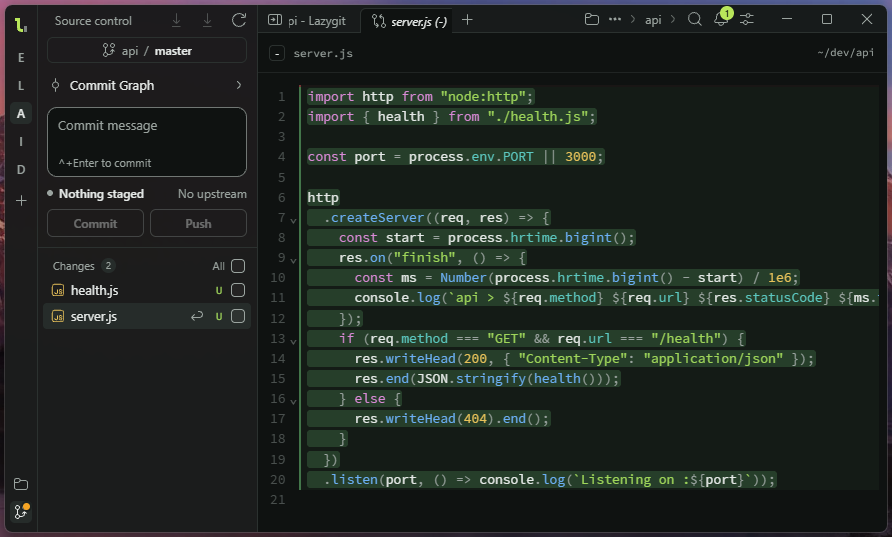

### Make it yours

17 built-in themes, light and dark, plus your own: create one in Settings or import a `.lut-theme` file.

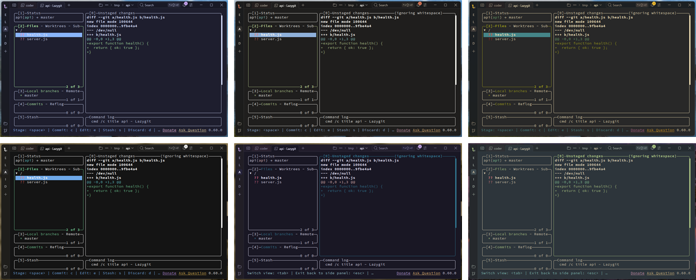

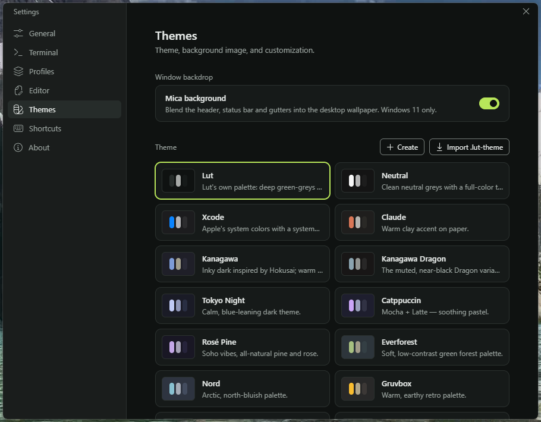

### Under the hood

- [Tauri 2](https://v2.tauri.app/): a Rust backend and a React + TypeScript frontend.
- [Ghostty](https://ghostty.org/)'s terminal core compiled to WebAssembly, drawn by a pooled WebGPU/WebGL renderer
  (`packages/ghostty-core`). TUIs like lazygit and Neovim just work.
- [portable-pty](https://crates.io/crates/portable-pty) for PTY sessions (ConPTY on Windows).

## What it won't do

- Ask you to log in, make an account or pay for something you don't need.
- Turn your commands into blocks, cells or notebooks. It's just a terminal.

## Install

`lut` is still in early development. Grab the latest release from [Releases](https://github.com/lucas-labs/lut/releases) and run the installer for your OS.

| OS      | Download                                      |
| ------- | --------------------------------------------- |
| Windows | `lut_<version>_x64-setup.exe`                 |
| macOS   | `lut_<version>_aarch64.dmg` or `_x64.dmg`     |
| Linux   | `.AppImage`, `.deb` or `.rpm` (x64 and arm64) |

`lut` updates itself from its own releases. The Windows installer isn't code-signed yet, so SmartScreen may warn you
the first time.

> [!WARNING]
> I'm stuck on Windows and haven't tested macOS or Linux yet. If you run into issues, please open an issue.
> And if you don't, please open an issue anyway: I want to know if it works for you on your OS.

## Credits

`lut` started from the source code of [Terax](https://github.com/crynta/terax-ai), imported at commit
[`a2c0877d`](https://github.com/crynta/terax-ai/tree/a2c0877d7fe81ed7b9560c3043d4b6c1ad9783c9)
(Apache-2.0, Copyright 2026 Crynta). Thanks to Crynta and the Terax contributors for the terminal engine `lut` builds
on.

## License

`lut` is licensed under the [Apache License 2.0](LICENSE). [`NOTICE`](NOTICE) records `lut`'s copyright and Terax's
attribution; bundled third-party components and their licenses are listed in
[`.docs/licensing.md`](.docs/licensing.md).
